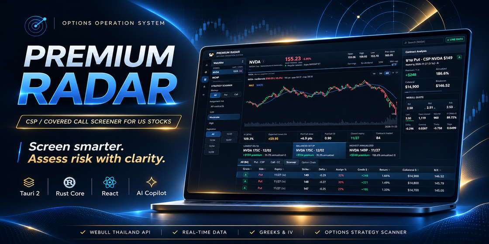

<p align="center">
  
</p>

<p align="center">
  <a href="https://github.com/b9b4ymiN/premium-radar/releases/latest"></a>
  <a href="https://github.com/b9b4ymiN/premium-radar/actions/workflows/ci.yml"></a>
  
  <a href="LICENSE"></a>
</p>

<p align="center">
  <b>English</b> · <a href="README.th.md">ภาษาไทย</a>
</p>

---

**PREMIUM RADAR** is a Windows desktop app for option sellers. It scans the US option chain of any stock through the **Webull Thailand OpenAPI**, grades every cash-secured put and covered call by premium, risk and liquidity, and explains each setup in plain language — with live quotes, Black-Scholes greeks, an interactive chart and an AI copilot grounded in the data on screen.

> [!WARNING]
> **Not financial advice.** PREMIUM RADAR is a screening and calculation tool for education. Grades, probabilities and AI answers can be wrong, and selling options carries substantial risk. You make — and own — every trading decision.

## Features

| | |
|---|---|
| **Strategy scanner** | Finds CSP and covered-call candidates by delta, DTE, spread, premium and your cash budget; grades each A / B / C with the reason in words. |
| **Live data** | Webull real-time push (MQTT) with REST fallback, after-hours and overnight sessions, quotes, open interest and the broker's own greeks. |
| **Quant engine** | Black-Scholes pricing, implied volatility, greeks, expected move, put/call skew and assignment probability — in Rust, verified against golden fixtures. |
| **Contract analysis** | Premium, annualised return, collateral, break-even, payoff at expiry, earnings and ex-dividend risk notes per contract. |
| **TradingView-style chart** | 5m to monthly timeframes, wheel zoom and pan, MA(5/20), volume, and drawing tools (trend line, ray, channel, Fibonacci, text) saved per symbol. |
| **Market & watchlists** | Gainers, losers, most active (re-sortable by traded value or market cap), 52-week highs/lows, sectors, local and broker watchlists. |
| **Option Lab** | Payoff and probability lab, scenario tables, frozen predictions and an accuracy journal. |
| **Recorder server (optional)** | A Docker service that keeps capturing Lab data on a schedule even while the app is closed. The app reads it over a token-protected API, or keeps recording locally as before. |
| **Radar Assistant** | Floating AI copilot (Z.ai GLM, OpenAI or a local Ollama model) that answers from the scanner's live data only. |
| **Thai time** | Every timestamp shows Thai time first (ET as a hint), plus a plain market clock such as "opens in 3 h (21:30)". |
| **Auto-update** | The app checks for a new release at start and updates in one click. |

## Download & install

Two files are on the [latest release](https://github.com/b9b4ymiN/premium-radar/releases/latest) page:

- **`PREMIUM-RADAR_x.y.z_x64-setup.exe`** — installer, recommended. Installs per-user and the app then updates itself in one click. If Microsoft Edge WebView2 is missing, the installer downloads it (internet required).
- **`PREMIUM-RADAR_x.y.z_x64-portable.exe`** — portable. No install — just run the file. No auto-update (the app links you to the release page instead) and it needs WebView2, which Windows 11 already includes.

Because the app is not yet code-signed, Windows SmartScreen may show **"Windows protected your PC"** — choose **More info → Run anyway**.

Requirements: Windows 10 or 11 (x64) and your own **Webull Thailand** account with OpenAPI access.

## Getting started

1. Open the app — the **Setup** screen appears on first run.
2. Enter **your own Webull App Key and App Secret** (from the Webull Thailand OpenAPI developer portal).
3. If your key needs an access token, press **Create token** (สร้าง token), confirm the SMS in the Webull app within 5 minutes, then **Test connection** (ทดสอบการเชื่อมต่อ).
4. Optionally add an AI provider for the Radar Assistant.
5. Optionally, under **Lab data source** (แหล่งข้อมูล Lab), switch from *this computer* to a **Recorder server**: enter its address and API token, then press **Test connection**. Leave the default if you do not run a server.
6. Press **Save & start** (บันทึกและเริ่มใช้งาน). A Thai user guide is in [`USAGE-TH.md`](USAGE-TH.md).

## Privacy & security

- **Read-only.** The app (and the recorder server) only read market and account data. It has no order placement, transfer or account-changing call.
- **Your keys stay on your machine.** Credentials live in the Windows Credential Manager (service `premium-radar`); they never reach the UI layer and are sent only to `https://api.webull.co.th`. Redirects are never followed with credential headers.
- **Quota-aware.** One shared request coordinator paces every call at 85 % of the documented Webull Thailand limits, with per-family windows and retry on rate limits.
- Found a security issue? Please open a private security advisory on this repository.

## Recorder server (optional)

The recorder collects option data for the Option Lab every trading day: a post-close snapshot (contracts up to 60 days, strikes within ±20 %) and intraday snapshots of the sellable zone (up to 45 days, ±15 %). It covers your core symbols plus the top 100 US stocks by market cap, refreshed weekly from the NASDAQ screener. Without a server, the app keeps recording on your own machine exactly as before.

```bash
cd deploy/recorder
cp .env.example .env   # set WEBULL_APP_KEY, WEBULL_APP_SECRET, RECORDER_API_TOKEN and
                       # WEBULL_ACCESS_TOKEN (create it in the desktop app: SMS, ~15 days)
docker compose up -d
docker compose exec recorder recorder-server plan   # dry run: next jobs and request estimates
```

- The API listens on `127.0.0.1:8787`. Put HTTPS in front with Tailscale or a Cloudflare Tunnel.
- `GET /health` needs no token. Everything under `/v1` (`status`, `dates`, `observations`, `export`, `universe`) needs `Authorization: Bearer <RECORDER_API_TOKEN>`. Without an API token the server refuses to start the API.
- The Webull access token expires after about 15 days: put the new one in `.env` and run `docker compose up -d` again. (A token file at `/data/secrets/access_token` in the volume also works.)
- Images are published to GHCR when a `recorder-v*` tag is pushed.

## Build from source

Prerequisites: Rust (stable, MSVC toolchain), Node.js LTS, and the Visual Studio C++ Build Tools.

```bash
git clone https://github.com/b9b4ymiN/premium-radar.git
cd premium-radar
npm install

npm run dev          # browser preview with mock data (no keys, no desktop shell)
npm run tauri dev    # the desktop app in dev mode
npm run tauri build  # NSIS installer + portable exe

npm run verify       # all gates: typecheck + lint, build, fmt, clippy, tests

cargo run -p recorder-server -- plan          # recorder dry run, no keys needed
docker build -t premium-radar-recorder:dev .   # recorder image
```

`RADAR_TIMING=1 npm run tauri dev` prints per-phase load timings of a scan.

## Architecture

```
crates/radar-core/   Rust domain logic, framework-free
  quant.rs           Black-Scholes, IV, greeks
  screener.rs        enrichment, grading, filters
  engine.rs          coalescing state store
  copilot.rs         LLM function calling
  lab/               Option Lab: payoff, probability, replay, calibration
  webull/            signing (V3 HMAC-SHA256), shared request coordinator,
                     REST clients, contract discovery, MQTT stream, protobuf
  universe.rs        top-100 market-cap list (NASDAQ screener, cache fallback)
crates/recorder-server/  headless recorder: NY-time scheduler + read-only token API
deploy/recorder/     docker compose example and .env template
src-tauri/           Tauri 2 shell: commands, settings + keyring, scan worker,
                     recorder API client
src/                 React 19 + TypeScript UI (KLineChart for the price chart)
docs/                Webull Thailand capability matrix; docs/dev/ developer notes
design/              design system and visual baseline
tests/fixtures/      golden fixtures for the quant, screener and signing tests
```

The Webull endpoints the app uses, and what the Thailand host actually returns, are documented in [`docs/WEBULL_TH_CAPABILITY_MATRIX.md`](docs/WEBULL_TH_CAPABILITY_MATRIX.md).

## Contributing

Issues and pull requests are welcome. Please run `npm run verify` before opening a pull request, and keep changes read-only towards the broker.

## License

[Apache-2.0](LICENSE) © 2026 THPForge
