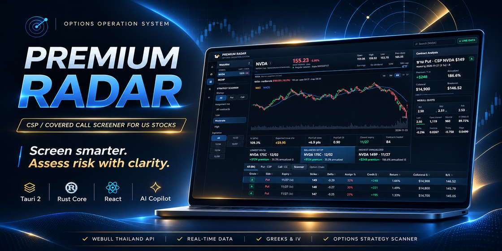

<p align="center">
  
</p>

<p align="center">
  <a href="https://github.com/b9b4ymiN/premium-radar/releases/latest"></a>
  <a href="https://github.com/b9b4ymiN/premium-radar/actions/workflows/ci.yml"></a>
  
  <a href="LICENSE"></a>
</p>

<p align="center">
  <a href="README.md">English</a> · <b>ภาษาไทย</b>
</p>

---

**PREMIUM RADAR** คือโปรแกรมบน Windows สำหรับคนที่ขาย option ใช้ดึง option chain ของหุ้นสหรัฐตัวไหนก็ได้ผ่าน **Webull Thailand OpenAPI** แล้วให้เกรดสัญญา cash-secured put และ covered call ทุกตัวตามค่าพรีเมียม ความเสี่ยง และสภาพคล่อง พร้อมอธิบายเหตุผลเป็นภาษาไทยที่อ่านเข้าใจง่าย มีราคาสด, ค่า greeks จากสูตร Black-Scholes, กราฟที่ซูมและวาดเส้นได้ และผู้ช่วย AI ที่ตอบจากข้อมูลจริงบนหน้าจอเท่านั้น

> [!WARNING]
> **ไม่ใช่คำแนะนำการลงทุน** — PREMIUM RADAR เป็นเครื่องมือคัดกรองและคำนวณเพื่อการศึกษา เกรด ค่าความน่าจะเป็น และคำตอบของ AI อาจผิดพลาดได้ การขาย option มีความเสี่ยงสูง ผู้ใช้ต้องตัดสินใจและรับผิดชอบเองทุกครั้ง

## ความสามารถหลัก

| | |
|---|---|
| **ตัวคัดกรองกลยุทธ์** | หาสัญญา CSP และ covered call ตาม delta, จำนวนวันถึงวันหมดอายุ, spread, พรีเมียม และงบที่มี แล้วให้เกรด A / B / C พร้อมเหตุผล |
| **ข้อมูลสด** | รับราคาแบบ real-time จาก Webull (MQTT) และถ้าใช้ไม่ได้จะสลับไปดึงผ่าน REST แทน แสดงราคาช่วง after-hours และ overnight, open interest และค่า greeks ของโบรกเกอร์ |
| **ระบบคำนวณ** | ราคา Black-Scholes, implied volatility, greeks, expected move, skew และโอกาสโดน assign เขียนด้วย Rust และตรวจกับชุดข้อมูลอ้างอิง (golden test) |
| **วิเคราะห์สัญญา** | พรีเมียม, ผลตอบแทนต่อปี, หลักประกัน, จุดคุ้มทุน, กำไร/ขาดทุนตอนหมดอายุ และคำเตือนเรื่องวันประกาศงบหรือวันขึ้นเครื่องหมายปันผล |
| **กราฟแบบ TradingView** | timeframe ตั้งแต่ 5 นาทีถึงรายเดือน, ซูมด้วยล้อเมาส์และลากเลื่อน, MA(5/20), volume และเครื่องมือวาด (trend line, ray, channel, Fibonacci, ข้อความ) ที่จำเส้นแยกตามหุ้น |
| **ตลาดและ Watchlist** | หุ้นขึ้นแรง, ลงแรง, ปริมาณหุ้นสูงสุด (เรียงใหม่ตามมูลค่าซื้อขายหรือมูลค่าตลาดได้), จุดสูง/ต่ำสุด 52 สัปดาห์, กลุ่มอุตสาหกรรม, watchlist ในเครื่องและของโบรกเกอร์ |
| **Option Lab** | ทดลองกลยุทธ์: กราฟกำไร/ขาดทุน, ความน่าจะเป็น, ตารางสถานการณ์ และบันทึกความแม่นยำของการคาดการณ์ |
| **Recorder server (ไม่บังคับ)** | บริการบน Docker ที่เก็บข้อมูล Lab ตามตารางเวลาให้เอง แม้ปิดแอปอยู่ แอปดึงข้อมูลผ่าน API ที่มี token หรือจะเก็บในเครื่องแบบเดิมก็ได้ |
| **Radar Assistant** | ผู้ช่วย AI แบบปุ่มลอย ใช้ได้กับ Z.ai GLM, OpenAI หรือ Ollama ในเครื่อง และตอบจากข้อมูลสดของตัวคัดกรองเท่านั้น |
| **เวลาไทย** | ทุกเวลาบนหน้าจอแสดงเป็นเวลาไทยก่อน (มีเวลา ET กำกับ) และมีบรรทัดบอกสถานะตลาด เช่น "ตลาดเปิดอีก 3 ชม. (21:30 น.)" |
| **อัปเดตอัตโนมัติ** | โปรแกรมเช็คเวอร์ชันใหม่ทุกครั้งที่เปิด และอัปเดตได้ในคลิกเดียว |

## ดาวน์โหลดและติดตั้ง

หน้า [Release ล่าสุด](https://github.com/b9b4ymiN/premium-radar/releases/latest) มีให้เลือก 2 ไฟล์:

- **`PREMIUM-RADAR_x.y.z_x64-setup.exe`** — ตัวติดตั้ง (แนะนำ) ติดตั้งแบบ per-user แล้วโปรแกรมอัปเดตตัวเองได้ในคลิกเดียว ถ้าเครื่องยังไม่มี Microsoft Edge WebView2 ตัวติดตั้งจะดาวน์โหลดให้ (ต้องต่ออินเทอร์เน็ต)
- **`PREMIUM-RADAR_x.y.z_x64-portable.exe`** — แบบพกพา ไม่ต้องติดตั้ง รันไฟล์นี้ได้เลย แต่ไม่มีอัปเดตอัตโนมัติ (โปรแกรมจะพาไปหน้า Release แทน) และต้องมี WebView2 ซึ่ง Windows 11 มีให้อยู่แล้ว

เพราะโปรแกรมยังไม่ได้ซื้อใบรับรอง code signing ถ้า Windows ขึ้นหน้าจอ **"Windows protected your PC"** (SmartScreen) ให้กด **More info → Run anyway**

ต้องใช้: Windows 10 หรือ 11 (x64) และบัญชี **Webull Thailand** ของคุณเองที่เปิดใช้ OpenAPI แล้ว

## เริ่มใช้งานครั้งแรก

1. เปิดโปรแกรม หน้า **Setup** จะขึ้นมาเอง
2. ใส่ **Webull App Key และ App Secret ของคุณเอง** (ขอได้จาก developer portal ของ Webull Thailand OpenAPI)
3. ถ้าบัญชีต้องใช้ Access Token ให้กด **สร้าง token** แล้วยืนยัน SMS ในแอป Webull ภายใน 5 นาที จากนั้นกด **ทดสอบการเชื่อมต่อ**
4. (ไม่บังคับ) ใส่ AI provider สำหรับ Radar Assistant
5. (ไม่บังคับ) ในส่วน **แหล่งข้อมูล Lab** ถ้ามี Recorder server ให้เลือก **Recorder server** แล้วใส่ที่อยู่ server กับ API token จากนั้นกด **ทดสอบการเชื่อมต่อ** ถ้าไม่ได้รัน server ใช้ค่าเริ่มต้น (ในเครื่องนี้) ได้เลย
6. กด **บันทึกและเริ่มใช้งาน** อ่านวิธีใช้งานแบบละเอียดได้ที่ [`USAGE-TH.md`](USAGE-TH.md)

## ความเป็นส่วนตัวและความปลอดภัย

- **อ่านอย่างเดียว** โปรแกรม (และ recorder server) ดึงข้อมูลตลาดและบัญชีมาแสดงเท่านั้น ไม่มีคำสั่งซื้อขาย โอนเงิน หรือแก้ไขบัญชีใดๆ
- **key อยู่ในเครื่องคุณเท่านั้น** เก็บใน Windows Credential Manager (ชื่อ service `premium-radar`) ไม่ถูกส่งไปที่หน้าจอโปรแกรม และส่งไปที่ `https://api.webull.co.th` ที่เดียว ไม่ตาม redirect ไปที่อื่นพร้อม key
- **ใช้ quota อย่างระวัง** ทุก request ผ่านตัวคุมจังหวะตัวเดียวกัน ที่ 85% ของ quota ที่ Webull Thailand กำหนด แยกนับตามกลุ่ม endpoint และลองใหม่อัตโนมัติเมื่อเจอ rate limit
- พบปัญหาด้านความปลอดภัย? กรุณาแจ้งผ่าน private security advisory ของ repository นี้

## Recorder server (ไม่บังคับ)

Recorder เก็บข้อมูล option ให้ Option Lab ทุกวันทำการ: ภาพหลังตลาดปิด (สัญญาอายุไม่เกิน 60 วัน, strike ±20%) และภาพระหว่างวันของช่วงที่ขายได้จริง (ไม่เกิน 45 วัน, ±15%) ครอบคลุมหุ้นหลักของคุณและหุ้น US 100 อันดับแรกตาม market cap ซึ่งอัปเดตรายชื่อทุกสัปดาห์จาก NASDAQ screener ถ้าไม่มี server แอปก็ยังเก็บข้อมูลในเครื่องได้เหมือนเดิมทุกอย่าง

```bash
cd deploy/recorder
cp .env.example .env   # ใส่ WEBULL_APP_KEY, WEBULL_APP_SECRET, RECORDER_API_TOKEN และ
                       # WEBULL_ACCESS_TOKEN (สร้างในแอป: ยืนยัน SMS, อายุ ~15 วัน)
docker compose up -d
docker compose exec recorder recorder-server plan   # ดูตารางงานและจำนวน request โดยไม่ยิงจริง
```

- API เปิดที่ `127.0.0.1:8787` ให้ใช้ Tailscale หรือ Cloudflare Tunnel ทำ HTTPS ด้านหน้า
- `GET /health` ไม่ต้องใช้ token ส่วนทุกอย่างใต้ `/v1` (`status`, `dates`, `observations`, `export`, `universe`) ต้องส่ง `Authorization: Bearer <RECORDER_API_TOKEN>` ถ้าไม่ได้ตั้ง API token ไว้ server จะไม่เปิด API
- access token ของ Webull หมดอายุประมาณ 15 วัน ให้ใส่ตัวใหม่ใน `.env` แล้วสั่ง `docker compose up -d` อีกครั้ง (หรือวางเป็นไฟล์ `/data/secrets/access_token` ใน volume ก็ได้)
- image จะถูก publish ขึ้น GHCR เมื่อ push tag `recorder-v*`

## Build จาก source

ต้องมี: Rust (stable, MSVC toolchain), Node.js LTS และ Visual Studio C++ Build Tools

```bash
git clone https://github.com/b9b4ymiN/premium-radar.git
cd premium-radar
npm install

npm run dev          # ดูหน้าตาใน browser ด้วยข้อมูลจำลอง (ไม่ต้องมี key)
npm run tauri dev    # เปิดโปรแกรมจริงในโหมด dev
npm run tauri build  # สร้างตัวติดตั้ง NSIS + ไฟล์ portable

npm run verify       # ตรวจทั้งหมด: typecheck + lint, build, fmt, clippy, test

cargo run -p recorder-server -- plan          # ดูแผนของ recorder โดยไม่ต้องมี key
docker build -t premium-radar-recorder:dev .   # build image ของ recorder
```

ตั้ง `RADAR_TIMING=1` ตอนรัน `npm run tauri dev` เพื่อดูเวลาที่ใช้ในแต่ละขั้นของการโหลดข้อมูล

## โครงสร้างโปรเจค

```
crates/radar-core/   Rust domain logic (ไม่ผูกกับ framework)
  quant.rs           Black-Scholes, IV, greeks
  screener.rs        enrichment, grading, filters
  engine.rs          ที่เก็บ state ล่าสุดของราคา
  copilot.rs         LLM function calling
  lab/               Option Lab: payoff, probability, replay, calibration
  webull/            signing (V3 HMAC-SHA256), ตัวคุมจังหวะ request, REST clients,
                     contract discovery, MQTT stream, protobuf
  universe.rs        รายชื่อหุ้น 100 อันดับตาม market cap (NASDAQ screener + cache)
crates/recorder-server/  recorder แบบ headless: ตั้งเวลาตามเวลานิวยอร์ก + API อ่านอย่างเดียวที่มี token
deploy/recorder/     ตัวอย่าง docker compose และไฟล์ .env ต้นแบบ
src-tauri/           Tauri 2 shell: commands, settings + keyring, scan worker,
                     client สำหรับ recorder API
src/                 React 19 + TypeScript (กราฟใช้ KLineChart)
docs/                capability matrix ของ Webull Thailand · docs/dev/ บันทึกสำหรับนักพัฒนา
design/              design system และต้นแบบหน้าตา
tests/fixtures/      ชุดข้อมูลอ้างอิงสำหรับ test ของ quant, screener และ signing
```

endpoint ของ Webull ที่โปรแกรมใช้ และข้อมูลที่ host ไทยส่งกลับมาจริง ดูได้ที่ [`docs/WEBULL_TH_CAPABILITY_MATRIX.md`](docs/WEBULL_TH_CAPABILITY_MATRIX.md)

## ร่วมพัฒนา

ยินดีรับ issue และ pull request กรุณารัน `npm run verify` ก่อนเปิด pull request และไม่เพิ่มคำสั่งที่เขียนข้อมูลไปที่โบรกเกอร์

## License

[Apache-2.0](LICENSE) © 2026 THPForge
